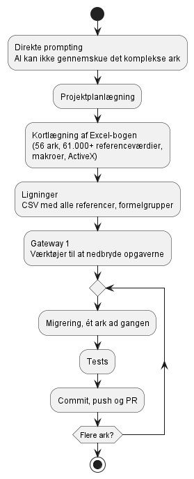

# Omstillingsparathed – ny opgave fra anden PO

**Læringsmål dækket:** [AI i softwareprojekter](https://tirsvad.studiesites.dk/laeringsmal-ai-til-softwarelosninger/) og [Dataanalyse og databehandling](https://tirsvad.studiesites.dk/laeringsmaal-dataanalyse-og-databehandling/)

Jeg fik mulighed for at vise mine nye kundskaber fra dataanalyse og AI, da en potentiel ny arbejdsgiver havde brugt 2 år på at få deres Excel-ark omsat til formler i VBA. Arket bestod af hvis/hvis/eller-sætninger med mange referencer. Denne post dokumenterer, hvordan jeg greb en opgave an, der lå langt fra mit hotelprojekt, og hvad jeg lærte af det.

## 🧭 Fra spaghetti-Excel til en ny produktionsklar version hver dag

### Kontekst: Excel-bogen

Excel-bogen, der skulle omsættes, bestod af:

- over 61.000 referenceværdier
- 56 Excel-ark
- makroer
- ActiveX-komponenter

### Udfordringerne

- Intet kendskab til VBA
- Kan ikke overskue spaghetti-referencer
- Ingen kendskab til domænesproget

### Hvad jeg kunne bringe med fra mine valgfag

- Hurtigt at få overblik over data.
- At bruge AI til at gennemskue referencerne i Excel-arket. Denne viden fik jeg gennem Udemy-kurset.
- Min generelle viden om systemudvikling: iteration og nedbrydning i små tasks. Den læring fik jeg gennem UCL-lektorerne.

### Første forsøg: direkte prompting skuffede

Først gik jeg direkte i gang med at prompte AI, og det skuffede mig. AI'en kunne ikke lave den opgave, jeg bad den om. Arket var for komplekst til, at AI'en kunne gennemskue det.

### Ny tilgang: projektplanlægning

Jeg ændrede tilgang og gik fra at prompte til at planlægge projektet. Vi startede med:

1. projektplanlægning
2. kortlægning af Excel-bogen
3. ligninger (formelgrupper)
4. migrering
5. tests

Opgaven blev delt op i små tasks, fx en CSV-fil med alle referencer og formelgrupper (hvis, hvis, ellers), og jeg tog ét ark ad gangen. AI'en accepterede planen og lavede flere gateways:

1. Første gateway: de værktøjer, der skulle bruges til at nedbryde opgaverne.
2. Derefter tog AI'en ét ark ad gangen, testede resultatet, og så fulgte commit, push og PR.

### Uforudset problem: makroerne forsvandt

Alt var grønne skove, indtil jeg opdagede, at alle makroerne forsvandt, når man kopierede et Excel-ark fra en lokation til en anden. Jeg måtte søge på nettet for at løse problemet: nogle indstillinger skulle ændres i Microsofts sikkerhedscenter. AI'en blev derefter fodret med den nye viden og ændringen.

### Resultatet

Forløbet var iterativt: Excel-workbooken fik en ny version hver dag, som kunne bruges i produktion. Firmaet havde ventet i over to år på en løsning fra den siddende projektleder, der skulle lave formlerne i VBA, og skal ikke længere vente på det "færdige ark".

### Hvad gjorde forskellen?

Jeg er sikker på, at min succes skyldes måden, jeg håndterede projektplanlægningen på, og ikke min programmeringsmæssige kunnen. Dog har jeg muligvis nyere viden om AI end den siddende person, der skulle programmere VBA.

## 🔄 Kolbs læringscirkel i praksis

**1. Konkret erfaring**

Jeg fik en opgave fra en anden PO, hvor jeg hverken kendte VBA eller domænet, og hvor Excel-arket havde mange komplekse referencer. Jeg prøvede først at prompte AI direkte, og derefter at planlægge projektet i små tasks.

**2. Refleksion**

- Hvorfor skuffede mit første forsøg?
  > Arket var for komplekst til, at AI'en kunne gennemskue det, så den kunne ikke lave den opgave, jeg bad den om.
- Hvad ændrede jeg?
  > Jeg gik fra direkte prompting til projektplanlægning: opgaven blev delt op i små tasks (CSV med alle referencer, formelgrupper), ét ark ad gangen, med gateways, test og commit/push/PR for hvert ark.
- Hvad gik galt undervejs?
  > Makroerne forsvandt, når et Excel-ark blev kopieret fra en lokation til en anden. Løsningen var at ændre nogle indstillinger i Microsofts sikkerhedscenter, som jeg fandt ved at søge på nettet.
- Hvad gjorde forskellen for resultatet?
  > Måden jeg håndterede projektplanlægningen på – ikke min programmeringsmæssige kunnen.
- Hvad kunne jeg gøre anderledes?
  > Starte med projektplanlægningen i stedet for at prompte direkte.

**3. Abstrakt begrebsliggørelse**

Jeg kobler erfaringen til teori om blandt andet:

- iterativ udvikling og nedbrydning af opgaver i små tasks
- gateways som kontrolpunkter i en plan
- AI's begrænsninger ved komplekse input (for stort et ark ad gangen)
- versionsstyring og review (commit, push, PR) som en del af arbejdsgangen
- at holde AI'en opdateret med ny viden, når en ændring i omgivelserne opdages
- omstillingsparathed: at overføre læring fra ét område til et nyt
- legacy-løsninger og spaghetti-referencer

**4. Aktiv eksperimenteren**

Jeg bruger samme tilgang på næste opgave: først planlægge og nedbryde i små tasks, derefter lade AI'en arbejde ét trin ad gangen med test og review. Når jeg støder på noget uforudset, som med makroerne, fodrer jeg AI'en med den nye viden, så den kan arbejde videre med den.

## 🎯 Hvilke kernemål i læringsmål dækkes

🟢 dækkes helt, 🟡 dækkes delvist, 🔴 dækkes kun lidt eller slet ikke endnu. Opgaven lå uden for hotelprojektet, så dækningen er vurderet ud fra, hvad opgaven faktisk indeholdt.

### Dataanalyse og databehandling

| Kerneområde | Vægt i læringsmål | Dækning | Begrundelse |
|---|---|:---:|---|
| Dataindsamling | Stor | 🟡 | Referencer og formelgrupper blev udtrukket til en CSV-fil |
| Datastrukturering | Stor | 🟡 | Formler og referencer blev struktureret i formelgrupper (hvis, hvis, ellers) |
| Datakvalitet | Stor | 🔴 | Ikke relevant for denne post |
| Datarensning | Stor | 🔴 | Ikke relevant for denne post |
| Dataanalyse | Stor | 🟡 | Jeg fik hurtigt overblik over data, men gennemførte ikke en egentlig dataanalyse |
| Statistik | Stor | 🔴 | Ikke relevant for denne post |
| Deskriptiv statistik | Stor | 🔴 | Ikke relevant for denne post |
| Trends og mønstre | Stor | 🔴 | Ikke relevant for denne post |
| Sammenhænge mellem variable | Stor | 🔴 | Opgaven handlede om afhængigheder mellem celler, ikke om statistiske sammenhænge |
| Datavisualisering | Stor | 🔴 | Ikke relevant for denne post |
| Fortolkning af resultater | Mindre | 🔴 | Ikke relevant for denne post |
| Formidling af data | Mindre | 🔴 | Ikke relevant for denne post |

### AI i softwareprojekter

| Kerneområde | Vægt i læringsmål | Dækning | Begrundelse |
|---|---|:---:|---|
| Python for AI | Stor | 🔴 | Opgaven blev løst i VBA |
| Machine Learning | Stor | 🔴 | Ikke relevant for denne post |
| AI til fortolkning af data | Stor | 🟡 | AI blev brugt til at gennemskue referencerne i Excel-arket |
| Large Language Models (LLM) | Stor | 🟡 | AI blev brugt som LLM til at forstå og omskrive formler |
| Modelvalg og model comparison | Stor | 🔴 | Ikke relevant for denne post |
| Prompt engineering | Stor | 🟡 | Min første, direkte prompt skuffede, og jeg skiftede til en planlagt tilgang med små tasks |
| Generativ AI | Stor | 🟢 | AI genererede VBA-formlerne ark for ark, så workbooken fik en ny produktionsklar version hver dag |
| AI-baseret beslutningsstøtte | Stor | 🔴 | Ikke relevant for denne post |
| OCR | Stor | 🔴 | Ikke relevant for denne post |
| Feature extraction | Stor | 🔴 | Ikke relevant for denne post |
| Fortolkning af hoteldata | Mindre | 🔴 | Opgaven handlede ikke om hoteldata |
| Test og evaluering af AI-output | Mindre | 🟡 | AI'en testede resultatet for hvert ark, før der blev committet |
| Fejlhåndtering og usikkerhed | Mindre | 🟡 | Det mislykkede første forsøg og de forsvundne makroer blev håndteret og løst |
| Human-in-the-loop | Mindre | 🟡 | Jeg styrede planen og gateways, og AI'en arbejdede inden for dem |
| Privacy og ansvarlig AI | Mindre | 🔴 | Ikke behandlet i denne post |

## 🏨 Hvilken værdi kan det give et hotel management-system?

Opgaven handlede ikke om hoteldata, men metoden kan overføres til hotelprojektet:

- **Nedbrydning før prompting:** Når en opgave er for kompleks til, at AI'en kan overskue den, hjælper det at dele den op i små tasks med gateways, ét delmål ad gangen. Det kan bruges, når større AI-funktioner til NF Hotel skal bygges.
- **Test og review for hvert trin:** At teste, committe, pushe og lave PR for hvert delresultat gør det lettere at opdage fejl tidligt og holde styr på ændringer.
- **Overføring af viden:** At kunne omstille sig til en ny opgave uden at kende domænet, ved at kombinere overblik over data, AI og systemudviklingsmetode, er relevant, når hotelprojektet skal samarbejde med andre systemer eller tage imod data fra uvante kilder.
- **Leverance i små skridt:** At levere en ny version, der kan bruges i produktion, hver dag i stedet for at vente på et "færdigt" resultat giver løbende værdi for brugeren.
