# Dataanalyse i NF Hotels markedsanalyse

**Dato:** 1/11 2026
**Læringsmål dækket:** [Dataanalyse og databehandling](https://tirsvad.studiesites.dk/laeringsmaal-dataanalyse-og-databehandling/) og [AI i softwareprojekter](https://tirsvad.studiesites.dk/laeringsmal-ai-til-softwarelosninger/)

Læringsmålet for dataanalyse kræver, at jeg beregner statistiske mål, finder trends og mønstre, vælger og begrunder visualiseringer og beskriver dataenes begrænsninger. Denne post er beviset for den del. Beviset er siden *Market analysis* i NF Hotels administration, som viser en kørsel af markedsanalysen over hotellets bookinger (kørt 1/11 2026 kl. 13:18, færdig kl. 13:38). Siden har også AI-opsummeringer skrevet af den lokale model phi4, men posten handler mest om dataanalysen; AI-delen er kun beskrevet, så langt jeg har vurderet den. Siden er siden første udgave udvidet med omsætning på værelser og en forecast-sektion.

## 🧭 Hvad analysen indeholder

Analysen er kørt på **156.686 bookinger** (alle bookinger). Nøgletal øverst viser, at 794 bookinger har prisen 0, og at der er 0 duplikerede booking-id'er. Under nøgletallene står en samlet fortolkning, som er regnet ud fra tallene og ikke skrevet af en AI.

Siden har ni analyser og en forecast-sektion. Hver har sine egne diagrammer:

| Analyse | Diagramtyper | Eksempel på indhold |
|---|---|---|
| Lead time | Søjler, donut, sorterede søjler, måned × år | Fordeling på 0–7, 8–30, 31–90 og 91+ dage |
| Cambodian holidays | – | Gennemsnitlige ankomster pr. dag på helligdage; ingen diagramdata i denne kørsel |
| Sæsonvariation og bookingtempo | Måned × år | Ankomster og bookinger pr. måned |
| Annulleringer | Søjler, sorterede søjler, måned × år | Annulleringsrate pr. depositumtype, lead time, kundetype, segment og antal særønsker |
| Værelsesværdi og opholdslængde | Donut, søjler | Estimeret værdi, opholdslængde og omsætning på værelser pr. måned |
| Gæste- og bookingmix | Donut, sorterede søjler, søjler | Gentagne gæster, måltid, parkering, værelsestype, land, antal gæster |
| Belægning | Måned × år | Belægningsprocent pr. måned |
| Belægning på helligdage | Søjler | Helligdage mod øvrige dage |
| Korrelationer | Varmekort | Spearman-korrelation mellem 12 bookingfelter |
| Forecast | Linjer med bånd | Ankomster, belægning og omsætning de næste 6 måneder, regnet ud fra 102 måneders historik |

### Valg af visualisering

Hvert diagram har tre faste tekster, som viser, hvordan jeg og systemet begrunder valget:

- **What it shows:** hvad diagrammet viser.
- **Why this chart:** hvorfor netop denne diagramtype. Eksempel: en donut bruges kun til 2–4 dele, der tilsammen er 100 %; selvstændige rater, der ikke summerer til 100 %, vises som søjler og aldrig som donut; mange kategorier vises som sorterede søjler; en lang række måneder vises som måned mod år, så en sæson ses som en mørk kolonne.
- **What it cannot say:** begrænsninger for det enkelte diagram.

De tre tekster er med i prototypen, fordi de gør begrundelsen synlig, mens jeg udvikler. De skal ikke med i produktionen, hvor en leder ikke har brug for at se, hvorfor en diagramtype er valgt.

### Skærmbilleder af diagrammerne

Skærmbillederne er taget af siden i den kørsel, som posten bygger på.

**Lead time:** søjler for bånd og donuts for annullering og kundetype.
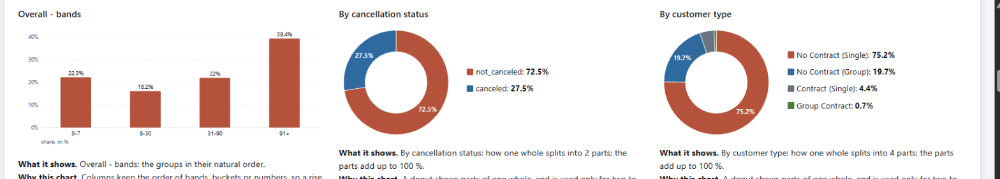

**Lead time:** sorterede søjler for markedssegment og måned × år for ankomstmåned.
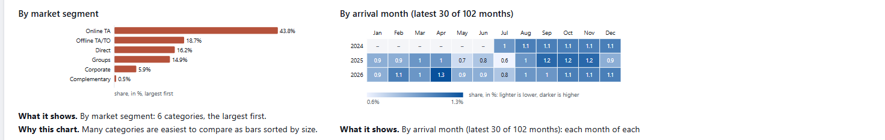

**Sæsonvariation og bookingtempo:** måned × år for ankomster og bookinger.
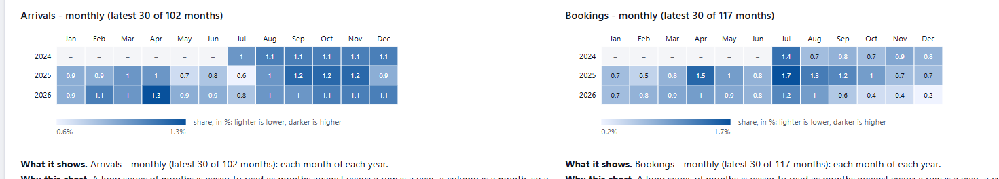

**Annulleringer:** søjler for depositumtype, lead time og kundetype.
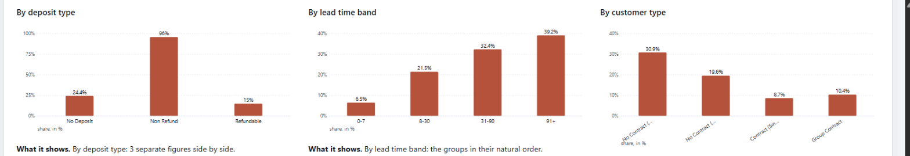

**Annulleringer:** sorterede søjler for markedssegment og søjler for særønsker og ændringer. Stjerner markerer grupper med få bookinger.
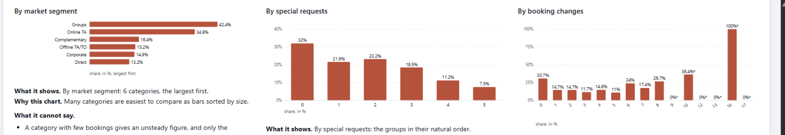

**Annulleringer:** måned × år for annulleringsrate pr. ankomstmåned.
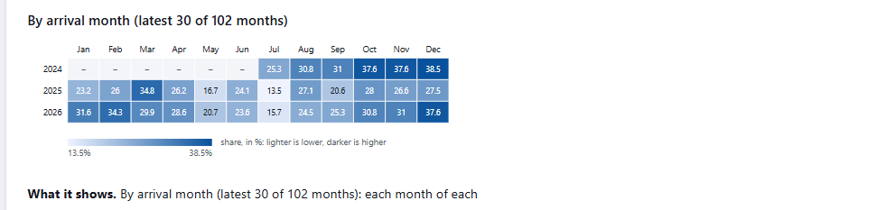

**Værelsesværdi og opholdslængde – omsætning:** søjler for omsætningen på værelser pr. ankomstmåned. Omsætningen er pris pr. nat gange antal nætter for de bookinger, der ikke er annulleret.
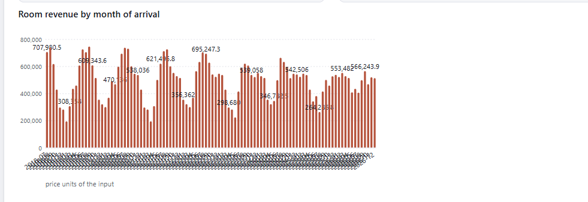

**Værelsesværdi og opholdslængde:** donut for estimeret værdi og søjler for opholdslængde.
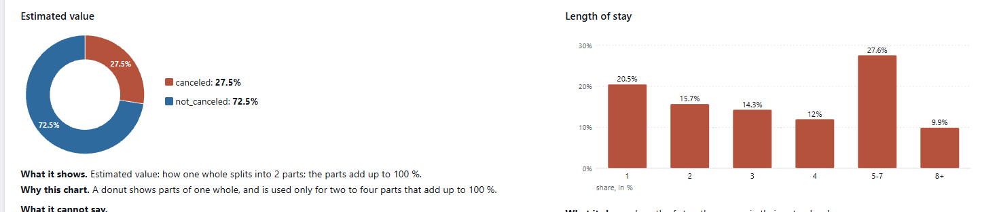

**Gæste- og bookingmix:** donut for gentagne gæster, sorterede søjler for måltid og søjler for parkering.
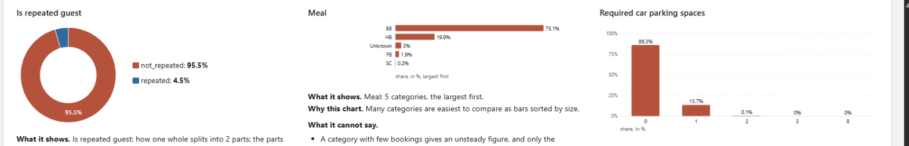

**Gæste- og bookingmix:** søjler for særønsker og sorterede søjler for værelsestype og land.
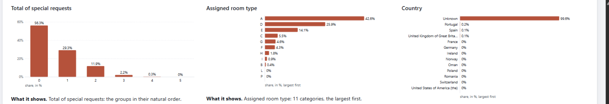

**Gæste- og bookingmix:** søjler for antal gæster pr. booking.
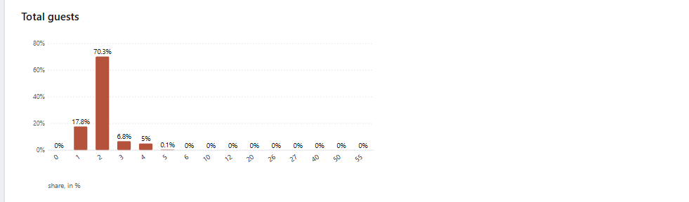

**Belægning:** måned × år for belægningsprocent.
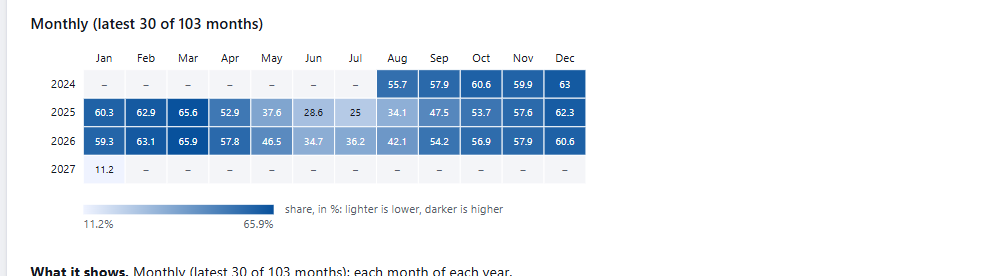

**Belægning på helligdage:** søjler for helligdage mod øvrige dage.
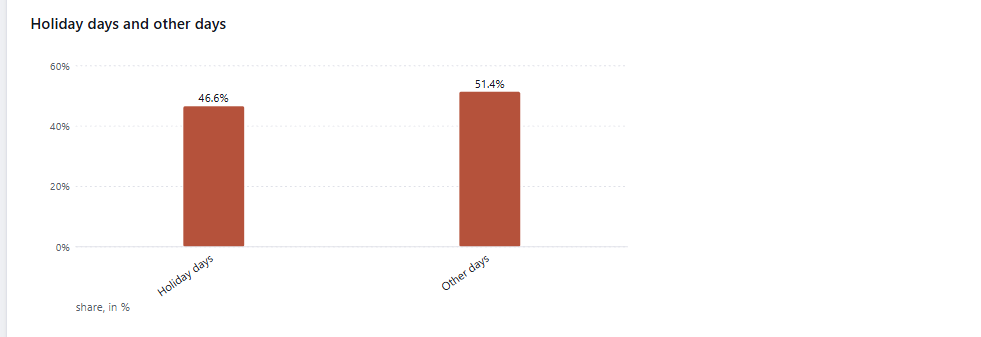

**Korrelationer:** varmekort over Spearman-korrelationer mellem 12 bookingfelter.
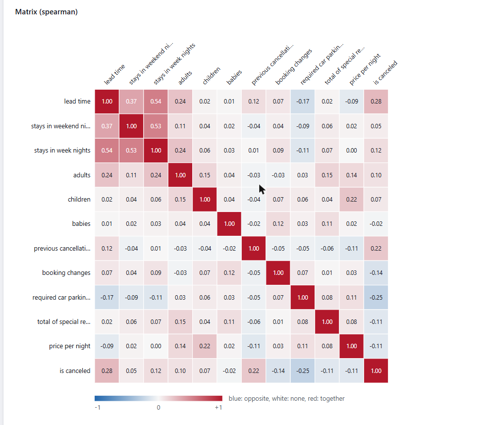

**Forecast:** linje med bånd for ankomster de næste 6 måneder. Prognosen er regnet af servicen, ikke af en AI.
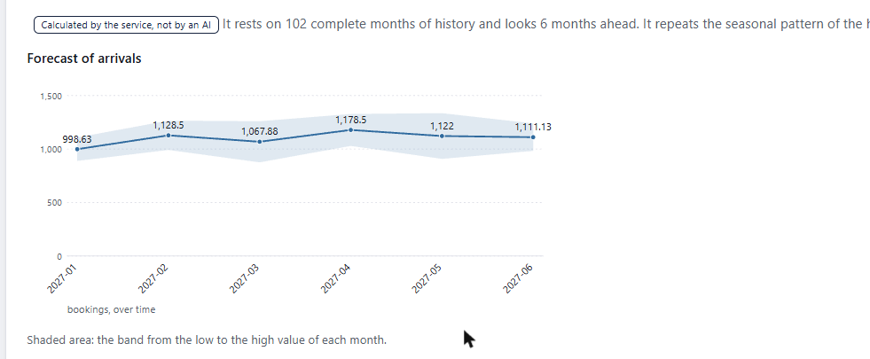

**Forecast:** linje med bånd for belægning de næste 6 måneder.
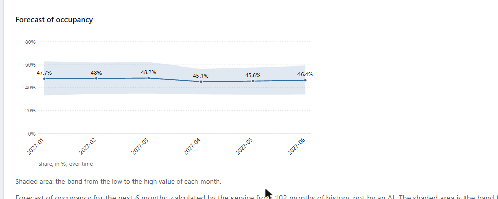

**Forecast:** linje med bånd for omsætning de næste 6 måneder.
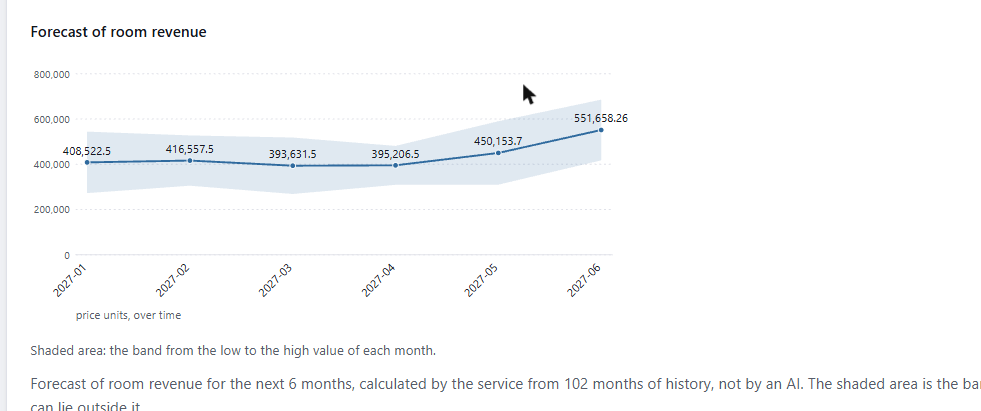

## 📊 Trends og mønstre

Jeg fandt følgende mønstre i resultaterne. Hvert er understøttet af en beregning og et diagram:

1. **Annullering stiger med lead time.** Annulleringsraten er 6,5 % for 0–7 dage, 21,5 % for 8–30, 32,4 % for 31–90 og 39,2 % for 91+. Samlet er 27,5 % annulleret.
2. **Gruppebookinger og online-bureauer annullerer mest.** Segmentet Groups har 42,4 % og Online TA 34,9 %, mens Direct har 13,2 %.
3. **Depositumtype hænger tæt sammen med annullering.** No Deposit 24,4 %, Refundable 15 % og Non Refund 96 %. Den høje rate for Non Refund er påfaldende og bør undersøges i dataene, før den tolkes.
4. **Belægningen er sæsonbestemt.** Belægningen er højest i marts (65,6 % i 2025 og 65,9 % i 2026) og lavest i sommermånederne (25,0 % i juli 2025 og 34,7 % i juni 2026).
5. **Helligdage har lavere belægning end øvrige dage.** 46,6 % mod 51,4 %. Forskellen er en sammenhæng og ikke en forklaring, da weekender og sæsoner også falder på helligdage.
6. **Korrelationer med annullering (Spearman):** lead time +0,28, tidligere annulleringer +0,22, krav til parkeringspladser −0,25, ændringer i booking −0,14 og antal særønsker −0,11. Lead time er også stærkt forbundet med antal hverdagsnætter (+0,54).

Fordelingerne giver også et billede af gæsterne: 4,5 % er gentagne gæster, 70,3 % rejser to personer, 75,1 % har morgenmad (BB), og 42,6 % har værelsestype A.

### Omsætning og forecast

Omsætningen på værelser er regnet som pris pr. nat gange antal nætter for de bookinger, der ikke er annulleret (113.551 bookinger, ingen udeladt på grund af manglende pris):

- **Samlet omsætning:** 50.769.820,9 prisenheder, i gennemsnit 447,11 pr. booking. Valutaen er ikke kendt, så beløbene er i inputtets prisenheder.
- **Omsætningen følger sæsonen:** i de seneste 30 måneder er den højeste måned juli 2024 (664.721,1) og den laveste juli 2025 (264.286,8). Sommer og vinterferie ligger højt, og forår og tidlig sommer ligger lavt.
- **Forecast for januar–juni 2027:** servicen gentager det sæsonmønster, der er i 102 hele måneders historik. Ankomster ligger mellem 998,6 og 1.178,5 pr. måned, belægningen mellem 45,1 % og 48,2 %, og omsætningen vokser fra 393.631,5 i marts til 551.658,3 i juni. Bånd om hver værdi viser spændet mellem laveste og højeste værdi for samme måned i historikken.
- **Hvad forecastet ikke kan:** det kender ikke trend, prisændringer, nye begivenheder eller ændret antal værelser, og båndet er spændet i historikken og ikke en sandsynlighed. Siden kalder det selv ikke et løfte.

## ⚠️ Begrænsninger og datakvalitet

Siden viser selv, hvad analyserne ikke kan sige. Det jeg lagde mærke til:

- Landet er `Unknown` for 99,6 % af bookingerne, så en analyse af gæsternes oprindelse er ikke mulig.
- 794 bookinger har prisen 0. De er med i værdien og tælles i `zero_price_records`.
- Den estimerede værdi er et estimat og ikke omsætning. Annullerede bookinger værdisættes som de øvrige.
- Bookinger uden de nødvendige felter udelades og tælles i `records_left_out`, så fraværet er synligt.
- Bookingtal og belægning dækker fremtidige måneder. Januar 2027 viser 11,2 % belægning, fordi perioden kun er delvist dækket.
- Omsætningen er før skatter, gebyrer, rabatter og ekstra ydelser, og valutaen er ikke kendt. Den er ikke regnskabsmæssig omsætning.
- Forecastet gentager kun sæsonmønsteret; det kender ikke trend eller nye begivenheder.
- Grupper med få bookinger er markeret med en stjerne. Eksempel: 16 ændringer i bookingen giver 100 %, men bygger på meget få bookinger.
- Korrelation er en sammenhæng og ikke en årsag. Spearman finder kun en jævn stigning eller et jævnt fald.
- Afsnittet om Cambodian holidays havde ingen diagramdata i denne kørsel.

## 🧩 Udfordringer undervejs

**Diagrammer fra Python til C#.** Analysen og diagrammerne laves i Python, men siden vises i C#-projektet. Jeg løser det ved at udvide JSON-skemaet, så det får et felt til SVG. Python tegner diagrammet som SVG og sender det med i svaret, og C# viser det uden selv at skulle tegne noget.

**Valg af LLM.** Jeg troede, at jeg havde valgt en god model, men den gik ikke i dybden med analysen. Derfor er jeg tilbage ved phi4. Den kræver en GPU, eller lang tid på CPU: kørslen af analysen med AI-opsummeringer over alle bookinger varede næsten 20 minutter (13:18–13:38). Det er en pris, som skal med i vurderingen af, hvordan AI-opsummeringerne kan køre i produktion. Det stemmer med benchmarken, hvor phi4 kørte 10,8 tokens i sekundet mod 85,8 for gemma4:e2b.

**Systemer på forskellige arkitekturer.** At få flere systemer til at spille sammen og ikke bare arbejde sammen kræver mere arbejde, end jeg forventede. Det er ikke nok, at hver del virker. Formatet mellem dem skal aftales, og kontrakten skal holdes i begge ender.

## 📚 Kilder til viden

Min viden om at arbejde med Python-API'er, som markedsanalysen er bygget på, har jeg fået gennem Udemy-kurset *100 Days of Code™: The Complete Python Pro Bootcamp*. Kursets API-projekter er dokumenteret i [Python og Pandas fra Udemy-kurset](2026-10-28_Python_og_Pandas_fra_Udemy-kurset.md). De mest relevante er:

- `033-iss-location`, `033-kanye-quotes`, `035-rain-alert`, `036-stocknews` og `038-nutritionix`: kald til eksterne API'er og behandling af svarene
- `025-weather`: Pandas på CSV-data, som er grundlaget for selve analysen

Viden om dataanalyse har jeg fra dag 71 og frem i samme kursus. De dage er endnu ikke med i det nye kursus-repository (`Tirsvad-Udemy-100-days-of-code`, som ender ved dag 41), så de ligger pt. i det gamle repository: [Tirsvad/udemy.python.100-days-of-code](https://github.com/Tirsvad/udemy.python.100-days-of-code). Dag 72 til 79 er rene dataanalyse-projekter:

- `day-72-data-exploration-with-pandas`: udforskning af data med Pandas
- `day-73-data-visualisation-programming_Languages`: visualisering af data om programmeringssprog
- `day-74-Lego_Analysis_for_Course`: analyse af LEGO-data
- `day-75-google-trends-data`: Google Trends-data og visualisering
- `day-76-google-play-store-project`: analyse af data fra Google Play Store
- `day-77-computing-with-numpy`: beregninger med NumPy og flerdimensionelle arrays
- `day-78-Seaborn_and_Linear_Regression`: Seaborn og lineær regression
- `day-79-Nobel_Prize_Analysis`: analyse af Nobelpris-data

Viden om at få diagrammer og analyser fra Python over i C#-projektet (JSON-skema med SVG-felt) kommer ikke fra kurset, men fra selve projektet.

## ➡️ Næste skridt: prisforslag med ét klik

Næste skridt er, at systemet automatisk foreslår prisændringer på værelser, som en medarbejder kun skal godkende med ét klik. Forslagene bygger på det, analysen allerede viser:

- **Højsæson:** et tillæg på 20 % på prisen. Belægningen er højest i marts og i vinterhalvåret (ca. 60–66 %), og forecastet viser, hvilke måneder der kommer.
- **Lavsæson:** rabat på enkelte værelser. Belægningen er lavest i sommermånederne (25 % i juli 2025), så det er dér, der er tomme værelser at fylde.

Forslagene skal være forklarlige og kunne afvises. Hvert forslag skal vise værelse, periode, ny pris og begrundelsen (belægning, forecast og evt. annulleringsrisiko), og prisen ændres først, når en medarbejder har godkendt den. Det er human-in-the-loop, og den del af læringsmålet om AI-baseret beslutningsstøtte kan jeg dokumentere her.

Det er ikke afgjort endnu:
- hvilke måneder og hvilken belægningsgrænse der udløser tillæg og rabat
- hvilke værelser der får rabat, og hvor stor den er
- om forslagene regnes af servicen, som forecastet, eller skrives af phi4
- hvordan godkendelser og afvisninger gemmes, så jeg bagefter kan se, om forslagene var gode

Jeg vil regne forslagene ud fra tal og kun lade AI'en forklare dem, fordi forecastet og belægningen allerede kommer fra servicen, og fordi prisen er en forretningsbeslutning, som skal kunne spores.

## 🔄 Kolbs læringscirkel i praksis

**1. Konkret erfaring**

Jeg kørte markedsanalysen på hotellets bookinger og gennemgik de ni analyser med diagrammer og begrænsninger. Derefter udvidede jeg siden med omsætning på værelser og en forecast-sektion og kørte analysen igen.

**2. Refleksion**

- Hvilke mønstre gav mest værdi?
  > Annullering efter lead time og segment, fordi de kan bruges til at vurdere risiko for tomme værelser, og belægning efter måned, fordi den viser, hvornår der er plads til flere bookinger.
- Hvad overraskede mig?
  > At Non Refund har 96 % annullering. Det er det modsatte af, hvad man forventer, og peger på noget i dataene, der skal undersøges. AI'ens tekster er også værd at tjekke: i forecast af omsætning skriver den beløb med dollartegn, selvom valutaen ikke er kendt, og flere af dens forslag til omsætning har evidensen "0 bookings".
- Hvad kan resultaterne ikke sige?
  > Årsager. Alt er sammenhænge, og landet er stort set ukendt, så oprindelse kan ikke analyseres.
- Hvordan stod jeg i forhold til fagområdet?
  > Markedsanalyse er ikke mit domænesprog. Jeg kender ikke fagets begreber og de analyser, man normalt vælger, så jeg har måttet støtte mig op ad AI til at forstå dem og til at vælge og fortolke analyserne. Det gør det ekstra vigtigt at kontrollere AI'ens svar mod tallene og at få en med hotelfaglig viden til at vurdere dem.
- Hvad kan jeg gøre bedre?
  > Vurdere AI-opsummeringerne systematisk mod tallene, undersøge Non Refund-fundet og få diagramdata for helligdagene i Cambodia med. Jeg skal også teste kontrakten mellem Python og C# tidligere, så uoverensstemmelser opdages, før de bliver en blokering.

**3. Abstrakt begrebsliggørelse**

Jeg kobler erfaringen til teori om blandt andet:

- deskriptiv statistik: rater, andele og fordelinger
- korrelation (Spearman) versus kausalitet
- valg af diagramtype efter hvad data skal vise (del af helhed, rater, rækkefølge, kategorier, tid)
- datakvalitet: manglende værdier, nulpriser og ukendte kategorier
- stikprøvestørrelse og usikkerhed ved få observationer
- belægningsprocent og opholdslængde i hotelbranchen

**4. Aktiv eksperimenteren**

Jeg kører analysen på andre perioder (seneste år og seneste tre år), ser om mønstrene holder, sammenligner forecastet med de faktiske tal, når månederne er gået, og undersøger Non Refund-fundet i de rå data. Prisforslagene med ét klik (se næste skridt) bliver den næste eksperimenterende fase.

## 🎯 Hvilke kernemål i læringsmål dækkes

🟢 dækkes helt, 🟡 dækkes delvist, 🔴 dækkes kun lidt eller slet ikke endnu.

### Dataanalyse og databehandling

| Kerneområde | Vægt i læringsmål | Dækning | Begrundelse |
|---|---|:---:|---|
| Dataindsamling | Stor | 🟡 | Bookinger hentes fra markedsanalysens API; indsamlingen er ikke dokumenteret her |
| Datastrukturering | Stor | 🟡 | Bookinger grupperet i bånd, segmenter, måneder og år |
| Datakvalitet | Stor | 🟡 | Nulpriser, ukendt land og manglende felter er tællet og synlige |
| Datarensning | Stor | 🟡 | Poster uden de nødvendige felter udelades og tælles; ingen selvstændig rensning i denne post |
| Dataanalyse | Stor | 🟢 | Ni analyser af 156.686 bookinger, plus omsætning og forecast |
| Statistik | Stor | 🟡 | Rater, andele, omsætning (sum og gennemsnit), Spearman-korrelation og forecast |
| Deskriptiv statistik | Stor | 🟡 | Fordelinger og rater; median og standardafvigelse er ikke set på siden |
| Trends og mønstre | Stor | 🟢 | Seks mønstre og omsætningens sæson, understøttet af beregning og diagram |
| Sammenhænge mellem variable | Stor | 🟢 | Korrelationsmatrix over 12 felter |
| Datavisualisering | Stor | 🟢 | Donut, søjler, sorterede søjler, måned × år, varmekort og linjer med bånd, hver med begrundelse |
| Fortolkning af resultater | Mindre | 🟡 | Fortolket i denne post; en samlet fortolkning mangler |
| Formidling af data | Mindre | 🟡 | Rapportsiden viser, hvad hvert diagram viser og ikke kan sige |

### AI i softwareprojekter

| Kerneområde | Vægt i læringsmål | Dækning | Begrundelse |
|---|---|:---:|---|
| Python for AI | Stor | 🔴 | Ikke relevant for denne post |
| Machine Learning | Stor | 🔴 | Ikke relevant for denne post |
| AI til fortolkning af data | Stor | 🟡 | phi4 skriver en opsummering og en observation til de fleste analyser; kvaliteten er kun vurderet stikprøvevis |
| Large Language Models (LLM) | Stor | 🟡 | phi4 kører lokalt i analysen; kørslen over alle bookinger tog næsten 20 minutter |
| Modelvalg og model comparison | Stor | 🟡 | Et tidligere modelvalg holdt ikke i den dybere analyse, så valget er tilbage ved phi4; begrundelsen er ikke dokumenteret endnu |
| Prompt engineering | Stor | 🔴 | Ikke relevant for denne post |
| Generativ AI | Stor | 🔴 | Ikke relevant for denne post |
| AI-baseret beslutningsstøtte | Stor | 🟡 | Siden viser forslag med evidens, men ikke alle forslag følger af evidensen |
| OCR | Stor | 🔴 | Ikke relevant for denne post |
| Feature extraction | Stor | 🔴 | Ikke relevant for denne post |
| Fortolkning af hoteldata | Mindre | 🟡 | Hoteldata fortolket af mig og af phi4; jeg har sammenlignet dem enkeltvis |
| Test og evaluering af AI-output | Mindre | 🟡 | Jeg har fundet AI-tekster, som evidensen ikke understøtter (dollartegn uden kendt valuta, evidens med 0 bookinger); en systematisk evaluering mangler |
| Fejlhåndtering og usikkerhed | Mindre | 🟡 | I en tidligere kørsel viste siden `GUARDRAIL_REJECTED` i stedet for at skjule, at et AI-svar blev afvist |
| Human-in-the-loop | Mindre | 🟡 | AI-tekst er mærket som hypotese og ikke prognose; det er mig, der vurderer den |
| Privacy og ansvarlig AI | Mindre | 🔴 | Ikke relevant for denne post |

## 🏨 Hvilken værdi kan det give et hotel management-system?

- **Kapacitet og bemanding:** Belægningen pr. måned viser, hvornår hotellet er fyldt (marts) og tomt (sommer), så bemanding og vedligeholdelse kan planlægges efter det.
- **Pris og overbooking:** Annullering efter lead time og segment viser, hvor risikoen for tomme værelser er størst, og kan bruges til priser og depositumregler.
- **Beslutninger med forbehold:** Hver graf siger, hvad den ikke kan sige, så en leder ikke tager en sammenhæng for en årsag.
- **Omsætning og forecast:** Omsætningens sæson og forecastet for de næste seks måneder kan bruges til budget og til at planlægge, hvornår der skal sælges flere værelser.
- **Driftsomkostning ved AI:** Valget af phi4 betyder, at hotellet skal have en GPU, eller leve med lang ventetid på CPU, hvis AI-opsummeringerne skal køre lokalt.
- **Datakvalitet som resultat:** At 99,6 % af landene er ukendte og 794 bookinger har prisen 0 er et konkret råd til dem, der registrerer bookinger.
