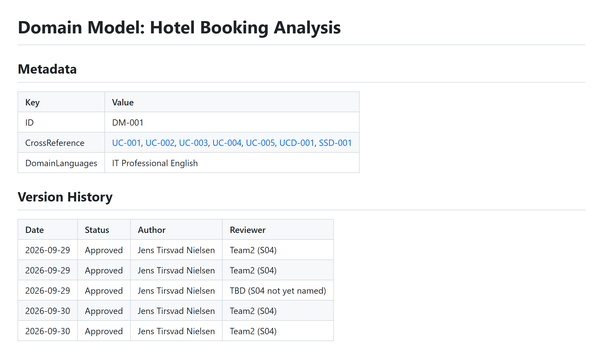
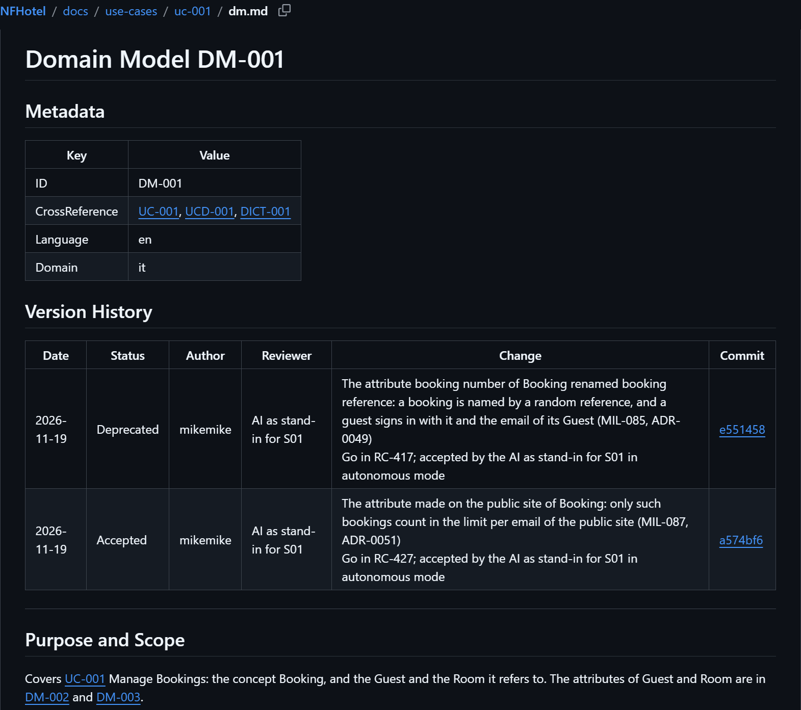

# Framework 1: Dokumentation, artefakter og krydsreferencer

**Dato:** 23/11 2026
**Læringsmål dækket:** [AI i softwareprojekter](https://tirsvad.studiesites.dk/laeringsmal-ai-til-softwarelosninger/) og [Dataanalyse og databehandling](https://tirsvad.studiesites.dk/laeringsmaal-dataanalyse-og-databehandling/)

Jeg har brugt meget tid på at lave et framework til dokumentation, kvalitetssikring og AI-genereret kode. For at kunne vise både udfordringerne og det, det giver mig på lang sigt, deler jeg arbejdet op i seks poster. Den sidste samler alle de gange, jeg tog fejl, reflekterede og ændrede frameworket, for det er dér, min udvikling som softwareudvikler kan ses:

1. **Dokumentation, artefakter og krydsreferencer** (denne post)
2. [AI laver artefakter med human-in-the-loop](2026-11-23_Framework–2_AI_laver_artefakter_med_human-in-the-loop.md)
3. [Kvalitetssikring af artefakter](2026-11-23_Framework–3_Kvalitetssikring_af_artefakter.md)
4. [AI laver kode ud fra artefakter](2026-11-23_Framework–4_AI_laver_kode_ud_fra_artefakter.md)
5. [Kvalitetssikring af koden](2026-11-23_Framework–5_Kvalitetssikring_af_koden.md)
6. [Fejl, refleksion og ændringer](2026-11-23_Framework–6_Fejl_refleksion_og_ændringer.md)

Denne post er fundamentet. Den viser, hvordan dokumenterne er bygget, og hvordan de hænger sammen, og den giver det samlede regnskab for, hvad frameworket har kostet. Beviset er fire repositories på min Gitea, som ændres sammen. Posten [Artefakt-færdighed – én samlet færdighed i stedet for 19](2026-09-21_Artefakt-færdighed–én_samlet_færdighed_i_stedet_for_19.md) og [Perspektivering – ensartede artefakter efter besøg fra LEGO](2026-10-28_Perspektivering–ensartede_artefakter_efter_besøg_fra_LEGO.md) handler om den første del af arbejdet; denne bygger videre på dem.

## 🧭 De fire repositories

Hvert repository har ét ansvar. En ændring hører hjemme i det repository, der ejer den, og ikke i det, der tilfældigvis er åbent.

| Repository | Ejer | Bruges af | Udgives som |
|---|---|---|---|
| [`sqa-qc-checklists`](https://git.tirsystem.com/TirSystem/sqa-qc-checklists) | QC-tjeklisterne: 33 tjeklister, 23 til dokumenter og 10 til kode og automatisering, med godt 400 kriterier i alt | frameworket | en commit, låst som undermodulet `qc/` |
| [`sqa-qc-framework`](https://git.tirsystem.com/TirSystem/sqa-qc-framework) (privat) | 5 skills, skabeloner, katalog, procesdokumenter og 26 scripts. Ingen projektdata | hvert projekt, som undermodulet `framework/` | et release-tag (`v0.1.0` til `v0.24`, 47 tags) |
| [`git-workflows`](https://git.tirsystem.com/TirSystem/git-workflows) | de delte workflows til CI og CD og de scripts, de kalder | alle repositories i organisationen | et release-tag og et flydende hovedtag (`v4.0.0`, 28 tags) |
| [`SQA-and-QC`](https://git.tirsystem.com/TirSystem/SQA-and-QC) | selve projektet: Business Case, milepæle, review-records og sporbarhedsmatrix | sig selv | den pull request, der fletter det |

`SQA-and-QC` er både frameworkets eget projekt og et eksempel på at bruge det. Hvis frameworket kan holde sit eget projekt, har jeg et bevis for, at det kan bruges.

### Hvad en artefakt er

Alle dokumenter er markdown-filer med den samme form:

- et **ID** med et kort navn og et versionsnummer (`BC-001` for Business Case, `MIL-005` for en milepæl, `RC-022` for en review-record)
- en tabel **Metadata** med ID, krydsreferencer, sprog og domæne
- en tabel **Version History** med dato, status, forfatter, reviewer, ændring og et link til den commit, der lavede ændringen
- links til andre dokumenter samlet nederst, mærket med målets ID (`[SA-001]`) og aldrig skrevet ind i teksten

Frameworkets katalog har 38 artefakttyper: 28 dokumenttyper og 10 typer til kode og konfiguration (Python, C, C++, C#, Rust, Flutter, React, shell, YAML og workflows). Dokumenttyperne hænger sammen i en kæde, hvor hver type kun kan oprettes, når de typer, den kræver, allerede findes. De vigtigste led er:

```
BC → SA → PP → MIL → US → UC → DM → SSD → OC → SD → DCD → (ERD) → kode
```

Kataloget har en kolonne `Requires` for dette. Scriptet `new-artifact.sh` nægter at oprette en artefakt, hvor kravet ikke er opfyldt.

## 🏷️ Hvordan jeg fandt frem til, hvad der skal stå i headeren

<!-- UDKAST: Dette afsnit er rekonstrueret ud fra changelogs, MIL-008 og scripts. Det skal rettes og udvides med, hvordan jeg selv husker, at jeg tænkte og besluttede. -->

Headeren (Metadata og Version History) er en lille datamodel for hvert dokument. Jeg satte den ikke op på forhånd. Når jeg læser changelog'en igennem, står hvert felt der, fordi noget gik galt uden det, eller fordi et script skulle læse det. Der er to spørgsmål, jeg kan stille til hvert felt: **hvem læser det**, og **hvad sker der, hvis det mangler eller er forkert?**

| Felt | Hvem læser det | Hvad der gik galt, eller hvorfor det står der |
|---|---|---|
| **ID** (`BC-001`) og kort navn | Links, sporbarhedsmatrixen og `new-artifact.sh`, som sætter ID'et ind og tæller registret op | Et ID er nøglen, alt andet peger på. Interessent-ID'er (`S01`) bruges som ejer og reviewer, aldrig et rollenavn |
| **CrossReference** | `find-crossreferences.sh` og de links, der står nederst i dokumentet | Kandidater i kataloget, men kun artefakter, der findes nu. For et use case citeres kun artefakter i samme mappe |
| **Language** | `check-languages.sh` (en gyldig BCP 47-kode), `QC-LANG-001` | To filer pr. artefakt gled fra hinanden. Sproget står nu i metadata, og ikke i filnavnet (0.4.0) |
| **Domain** | `check-languages.sh` og ordbogen (`DICT`) | Værdien skal være fra en liste i registret (`it`, `medical`, `construction`). Det er en kontrolleret liste, så to dokumenter ikke skriver det samme domæne på to måder |
| **Status** i Version History | `check-plan.sh` og `sync-project.sh`, som læser den sidste række | Alle skabeloner startede som `Accepted`, så en ny milepæl bestod gaten, og scriptet læste en hvilken som helst `Accepted`-række (0.4.0). Nu er det den sidste række |
| **Reviewer** | Den, der læser, hvem der har gennemgået | Et ID fra Stakeholder Analysis. I processen stod en pladsholder (`<reviewer S-ID>`), til 0.23.5 satte S07 ind |
| **Commit** | En læser, der vil se, hvad der blev ændret | Et dokument kan ikke indeholde sin egen commit-hash, så der står `pending`, og `resolve-pending-commits.sh` erstatter den bagefter |
| **Change** | Reviewer | Flere linjer (`<br>`), så en ændring kan beskrives uden at blive en ny række |
| **Nøglerne på engelsk** | Alle scripts | Overskrifter, nøgler og statusser er engelske, fordi scripts læser dem. Det blev besluttet 3/10 (MIL-008) |

**Op imod NF Hotel.** Projektet `Notebook_Market_Analysis` står stadig på frameworkets udgave `v0.1.0`, og dets dokumenter viser, hvordan headeren så ud, før jeg ændrede den: versionshistorikken har kun fire kolonner (dato, status, forfatter og reviewer), ingen ændringsbeskrivelse og intet link til commit'en, og projektplanen `PP-001` har 11 rækker fra to dage (29/9 og 30/9). Statussen er `Approved`, og hvert dokument har en `DomainLanguages`-række. Det er præcis de felter, jeg senere fjernede eller ændrede, så projektet er et før-billede, jeg kan måle migreringen på.

Her er headeren i NF Hotels Domain Model (`DM-001`). `CrossReference` peger på syv andre artefakter, og hvert ID er et link. Versionshistorikken har ingen `Change`- og `Commit`-kolonne, og de fem rækker siger alle `Approved`, så man kan ikke se, hvad der skiftede mellem dem. Fem rækker er også for mange. Reglen i frameworket er højst **to** rækker, og git har resten (den står i changelog'en for 0.1.0 og 0.1.1). NF Hotels dokumenter blev skrevet, før reglen kom, og er aldrig konverteret, så billedet viser et dokument, der bryder den regel, som frameworket har i dag.



Til sammenligning er her en Domain Model (`DM-001` for use case `UC-001`) i NF Hotels repo `NFHotel`, som bruger den nuværende udgave af frameworket. Det er et skærmbillede fra GitHub. `CrossReference` er stadig links (her til use casen, use case-diagrammet og ordbogen), og `DomainLanguages` er blevet til `Language` og `Domain`. Versionshistorikken har kun de to seneste rækker. Hver række har en `Change`-beskrivelse med henvisning til milepæl, ADR og review-record (`MIL-085`, `ADR-0049`, `RC-417`) og et link til den commit, der lavede ændringen. Reviewer er `AI as stand-in for S01`, så man kan se, at det var AI'en og ikke en person, der gennemgik.



*Det første billede er gengivet lokalt fra markdown-filen i `Notebook_Market_Analysis`, fordi repoet er privat. Det andet er et skærmbillede fra GitHub.*

De felter, der **ikke** er der mere, viser det samme:

| Hvornår | Hvad der blev fjernet eller indført | Hvorfor |
|---|---|---|
| 0.1.x | `Applies To` i tjeklisterne fjernet. Versionshistorikken holder kun de to seneste rækker. `Approved` er udgået som status | Tjeklisterne skulle kunne bruges uden mit projekt, git har resten af historikken, og to ord for en godkendelse er forvirrende |
| 0.3.0 (2/10) | `DomainLanguages`-rækken fjernet fra skabelonerne. Sprog og registre bor i registret | En række i hvert dokument hører hjemme som en indstilling ét sted |
| 0.4.0 (5/10) | `Language` og `Domain` i hvert dokument, med kontrol | Beslutningen om én fil pr. artefakt. Så skal sproget kunne læses i selve filen |
| 0.23.3 og 0.23.4 (13/11) | De sidste rester af `DomainLanguages` fjernet i tjeklister og process-dokumenter | `check-languages.sh` fejler på en rest i `docs/`, men process-dokumenterne ligger uden for den mappe |

**Det er en datamodel, og den kan kontrolleres som data.** ID'et er en nøgle, `CrossReference` peger på andre nøgler, `Language` er en kontrolleret kode, og `Domain` er en værdi fra en fast liste. `check-languages.sh` er et lille datakvalitetstjek: den finder manglende eller pladsholder-værdier (fuldstændighed), en sprogkode, der ikke er BCP 47 (gyldighed), et domæne uden for listen (konsistens), en forældet kolonne og en oversat tvilling ved siden af originalen. De dobbelte `RC-084` var et brud på entydighed, som ingen kontrol fangede, og som jeg opdagede i hånden.

## 🔗 Krydsreferencer og sporbarhed

Kataloget har også en kolonne med **kandidater til krydsreferencer** for hver type. En Use Case peger fx på sit Use Case Diagram, sine User Stories, sine interessenter og sit Domain Model. Det er en liste af kandidater og ikke et krav: et dokument må kun pege på en artefakt, der findes nu.

| Mekanisme | Hvad den sikrer |
|---|---|
| `CrossReference` i Metadata | Hvert dokument viser, hvad det bygger på |
| `find-crossreferences.sh` | Krydsreferencen kan kontrolleres igen, når der kommer nye artefakter |
| Sporbarhedsmatrix (`TM-001`) | Bagudgående og fremadgående link for hver artefakt og hvornår den sidst blev reviewet. Den gør Business Casens mål om 95 % sporbarhed målbart |
| Interessent-ID'er (`S01`) | Ejere og reviewere er altid et ID fra Stakeholder Analysis og aldrig et rolle-navn, jeg selv finder på |

Når den første artefakt af en ny type oprettes, skal den føjes til krydsreferencen i alle eksisterende dokumenter, der har typen som kandidat. Det er et godt eksempel på noget, som er kedeligt at gøre i hånden og nemt at glemme, og som et script gør det samme hver gang.

## 🛠️ Scripts, der tager det rutineprægede

Frameworket overlader det deterministiske til scripts og det, der kræver dømmekraft, til AI og menneske:

| Script | Hvad det gør |
|---|---|
| `new-artifact.sh` | Opretter et dokument ud fra skabelonen med ID, krydsreferencer, links, sprog og domæne udfyldt |
| `find-crossreferences.sh` | Finder, hvilke relaterede artefakter der findes |
| `resolve-pending-commits.sh` | Erstatter `pending` i versionshistorikken med linket til den commit, der blev lavet |
| `check-languages.sh`, `check-readme.sh`, `check-qc-tags.sh` | Fejler, når et dokument, en README eller en tjekliste afviger fra reglerne |
| `install-skills.sh`, `update-framework.sh` | Kopierer skills til det sted, agenten leder, og skifter til en ny udgave af frameworket |

Der er 26 shell-scripts, og 11 af dem er testscripts, som bygger et lille projekt og sammenligner exit-koder.

## 🧩 Udfordringer undervejs

**Kontekst, der fyldte for meget.** Min første version havde én skill pr. artefakttype (19). De fyldte meget i agentens kontekst og gentog de samme afsnit. Jeg samlede dem i én skill med en lille reference pr. type. Det er beskrevet i [Artefakt-færdighed](2026-09-21_Artefakt-færdighed–én_samlet_færdighed_i_stedet_for_19.md): beskrivelserne, som altid indlæses, gik fra ca. 1.550 til ca. 115 tokens, og redigering af en Business Case fra ca. 4.000 til ca. 1.400 (groft estimat).

**Et dokument kan ikke indeholde sin egen commit.** Versionshistorikken skal linke til den commit, der lavede ændringen, men en commits hash kendes først, når den er lavet. Løsningen er `pending`, som scriptet erstatter i en efterfølgende commit. Der må ikke bruges amend, fordi hashen så ændres, og linket peger på en commit, der aldrig bliver pushet. Reglen virker, men den kræver, at jeg og AI'en husker den. Historikken har kun de to seneste rækker, fordi git har resten.

**Ét sprog pr. dokument.** Først havde jeg en dansk og en engelsk udgave af hvert dokument. De gled fra hinanden. Nu findes hvert dokument én gang. De typer, der skrives på produktejerens sprog, har rækkerne `Language` og `Domain`; de tekniske typer (fx Design Class Diagram og review-records) er altid på engelsk. Overskrifter, nøgler, ID'er og statusser er altid engelske, fordi scripts læser dem. En ordbog (`DICT`) oversætter produktejerens ord til de tekniske ord, så Domain Model bruger produktejerens ord, mens Operation Contract og Design Class Diagram bruger de tekniske.

**Fire repositories, der ændres sammen.** En ændring i en tjekliste skal gennem tjeklisterne, frameworket og projektet. Derfor er der regler om rækkefølge: én pull request pr. repository i afhængighedsrækkefølge, en pin flyttes kun til en flettet commit eller et tag, og intet udgives, før dets afhængigheder er flettet. Det er mere arbejde end ét repository, men det holder frameworket uden projektdata.

**Parallelle grene gav samme nummer.** To grene lavede hver sin review-record med nummer `RC-084`. Jeg opdagede det, da jeg løste en merge-konflikt mellem dem, omdøbte den ene til `RC-090` og rettede referencerne. Numrene deles ud fra en tæller i registret, og to grene kan tage det samme nummer. Det er en fejl, et script kan fange, og den ligger på listen over næste skridt.

## 🔁 Fejl, refleksion og ændring

<!-- UDKAST: Tabellen bygger på changelogs og records. Refleksionerne er formuleret ud fra dem og skal rettes til mine egne ord. -->

Dokumentationen er det sted, hvor jeg skiftede mening flest gange. De største fejl, vist som Kolbs læringscirkel, står i [post 6](2026-11-23_Framework–6_Fejl_refleksion_og_ændringer.md).

| Hvad gik galt | Hvad jeg fandt ud af | Hvad jeg ændrede |
|---|---|---|
| 19 skills, én pr. artefakttype (21/9) | De fyldte i agentens kontekst | Én skill med en reference pr. type |
| Skabelonen til registret var nævnt i installationen, men fandtes ikke, og to skabeloner lå i en forkert mappe og pegede på en forkert katalogsti (0.1.x) | Dokumentationen var ikke afprøvet, som en ny bruger ville bruge den | Skabelonen blev lavet og filerne flyttet |
| En dansk og en engelsk udgave af hvert dokument (0.3.0) | De gled fra hinanden | Én fil pr. artefakt på produktejerens sprog, besluttet 3/10 (0.4.0) |
| Use case-mapper direkte i `docs/` | De fyldte øverste niveau | `docs/use-cases/uc-NNN/` (0.9.0) |
| 63 filer med CRLF-linjeskift (0.7.0) | Linjeskift ændrer hvert linjes diff | Alle er LF, med `.gitattributes` og `.editorconfig` |
| Kontrollen af README-overskrifter fik emoji som argumenter, og de blev ødelagt på Windows (0.4.0) | Et script må ikke få emoji som argumenter, når git kører det | Overskrifterne læses fra filer |
| Wiki-mappen havde en undermappe, og udgiveren fejlede med "has no Markdown pages" (0.19.1) | Wikien skal være flad | `process/wiki.md` siger det, og sidebar-reglen står i `QC-WIKI-001` |
| To grene tog samme `RC`-nummer (`RC-084`) | Numrene deles ud fra en tæller, to grene kan tage på samme tid | Jeg omdøbte den ene til `RC-090`. Et script bør finde den slags |

**Det, jeg tager med:** Det, der virker for mig, er ikke det samme som det, en ny bruger kan følge. Hver gang et felt, en mappe eller en regel blev flyttet, fik jeg en migrering. Derfor skriver jeg nu beslutningen og begrundelsen ned, før jeg ændrer.

## 📚 Kilder til viden

Frameworkets opbygning bygger på:

- Larmans use case-drevne rækkefølge, som kataloget følger
- ISO/IEC 25010:2023 til tagging af kriterier (se [post 3](2026-11-23_Framework–3_Kvalitetssikring_af_artefakter.md))
- mine egne erfaringer med skills og token-forbrug fra [posten om artefakt-færdigheden](2026-09-21_Artefakt-færdighed–én_samlet_færdighed_i_stedet_for_19.md)

Tallene i posten er talt i repositories den 23/11 2026. Git-historikken i de nuværende repositories starter 28/9–3/10 (frameworkets første commit er en import af udgave 0.1.0 den 1/10), men arbejdet begyndte før, som posten fra 21/9 viser.

## 📈 Hvad det har kostet, og hvad det giver på lang sigt

**Pris.** Git viser 1.377 commits fordelt på de fire repositories: 420 i `SQA-and-QC`, 306 i frameworket, 93 i tjeklisterne og 558 i `git-workflows`. Der er 47 framework-tags og 28 tags i `git-workflows`. Et antal commits er ikke et antal timer, og jeg har ikke regnet timer med her. Det er et groft mål for omfanget.

**Gevinst.**

| Gevinst | Hvorfor |
|---|---|
| Genbrug | Hver af kursets projektmapper i Udemy-kurset ([Gennemførelse af Udemy-kursus](2026-11-23_Gennemførelse_af_Udemy-kursus.md)) har en `framework/`-mappe, en `AGENTS.md` og review-records under `docs/sqa/reviews`: 114 af 118 mapper. Frameworket er altså brugt på over hundrede små projekter og ikke kun på det projekt, det er lavet i |
| Sporbarhed | Fra en milepæl kan jeg følge links til Business Case, interessenter og review. Det er ikke noget, jeg skal rekonstruere bagefter |
| Færre tokens | Agenten læser en fast, lille struktur og ikke 19 skills, så der er mere plads til selve opgaven |
| Konsistens | Hvert dokument ser ens ud, så jeg og en læser ved, hvor oplysningerne står |
| Fælles udgangspunkt | Et nyt projekt starter fra samme AGENTS.md, katalog og skabeloner i stedet for et tomt dokument |

**Risiko, jeg har lært at se.** Skabeloner, scripts og tjeklister skal vedligeholdes. Når jeg ændrer en regel, skal alle dokumenter, den gælder, tjekkes igen. Det koster tid på lang sigt, og det kommer jeg tilbage til i [post 3](2026-11-23_Framework–3_Kvalitetssikring_af_artefakter.md).

## ➡️ Næste skridt

- Lade et script finde dobbelte `RC`-numre ved en merge, så konflikten ikke kræver, at jeg opdager den i hånden.
- Prøve frameworket på et projekt, hvor jeg ikke selv har skrevet reglerne, så jeg kan se, hvad en anden må gætte på.
- Måle token-forbruget igen med et rigtigt tællerværktøj og ikke kun med et groft estimat.

## 🔄 Kolbs læringscirkel i praksis

**1. Konkret erfaring**

Jeg byggede frameworket i fire repositories, lavede skabeloner, katalog og scripts og brugte det på mit eget projekt og på kursets projekter.

**2. Refleksion**

- Hvad var sværest?
  > At holde mange dokumenter ensartede og linket sammen uden at lave det om til et arbejde, der kun består i at vedligeholde reglerne. Scripts er det, der gør det muligt.
- Hvad overraskede mig?
  > At de små detaljer, som at et dokument ikke kan indeholde sin egen commit-hash, kostede lige så meget tid som de store valg.
- Hvad er jeg stolt af?
  > At frameworket kan bruges på andre projekter uden at tage projektdata med.
- Hvad er prisen?
  > Meget tid. Den skal jeg have igen gennem genbrug.
- Hvad kan jeg gøre bedre?
  > Måle, hvor meget tid frameworket sparer på et nyt projekt, så jeg kan sammenligne med tiden, jeg lagde i det.

**3. Abstrakt begrebsliggørelse**

Jeg kobler erfaringen til teori om blandt andet:

- dokumentationsstyring og standardisering
- sporbarhed (traceability) mellem krav, design og kode
- deterministiske scripts versus AI-vurdering
- DRY og adskillelse af ansvar (framework og projektdata)
- semantisk versionering og afhængigheder mellem repositories
- kontekstøkonomi i AI-skills
- datamodellering: skema, nøgler, kontrolleret ordforråd og datakvalitet (fuldstændighed, gyldighed, konsistens og entydighed)

**4. Aktiv eksperimenteren**

Jeg bruger frameworket på de næste projekter og tæller, hvad det sparer. De næste fem poster viser, hvordan AI laver artefakter og kode oven på det, og hvad jeg lærte af at tage fejl.

## 🎯 Hvilke kernemål i læringsmål dækkes

🟢 dækkes helt, 🟡 dækkes delvist, 🔴 dækkes kun lidt eller slet ikke endnu. Posten handler om dokumentation af software. Den dækker ikke dataanalyse, men headeren kan læses som en lille datamodel, og det giver delvis dækning af datastrukturering og datakvalitet.

### Dataanalyse og databehandling

| Kerneområde | Vægt i læringsmål | Dækning | Begrundelse |
|---|---|:---:|---|
| Dataindsamling | Stor | 🔴 | Ikke relevant for denne post |
| Datastrukturering | Stor | 🟡 | Headeren er en lille datamodel med nøgle, fremmed nøgle og kontrolleret kode. Den er ikke tabeller i en database, og jeg har ikke normaliseret noget |
| Datakvalitet | Stor | 🟡 | `check-languages.sh` tjekker fuldstændighed, gyldighed og konsistens. Det gælder metadata og ikke et datasæt, og jeg har ikke målt fejlrater |
| Datarensning | Stor | 🔴 | Ikke relevant for denne post |
| Dataanalyse | Stor | 🔴 | Ikke relevant for denne post |
| Statistik | Stor | 🔴 | Ikke relevant for denne post |
| Deskriptiv statistik | Stor | 🔴 | Ikke relevant for denne post |
| Trends og mønstre | Stor | 🔴 | Ikke relevant for denne post |
| Sammenhænge mellem variable | Stor | 🔴 | Ikke relevant for denne post |
| Datavisualisering | Stor | 🔴 | Ikke relevant for denne post |
| Fortolkning af resultater | Mindre | 🔴 | Ikke relevant for denne post |
| Formidling af data | Mindre | 🟡 | Ensartet dokumentation med sporbarhed gør formidling lettere, men posten handler ikke om data |

### AI i softwareprojekter

| Kerneområde | Vægt i læringsmål | Dækning | Begrundelse |
|---|---|:---:|---|
| Python for AI | Stor | 🔴 | Scripts er skrevet i Bash |
| Machine Learning | Stor | 🔴 | Ikke relevant for denne post |
| AI til fortolkning af data | Stor | 🔴 | Ikke relevant for denne post |
| Large Language Models (LLM) | Stor | 🟡 | Strukturen reducerer tokenforbruget; tallene er et groft estimat |
| Modelvalg og model comparison | Stor | 🔴 | Ikke relevant for denne post |
| Prompt engineering | Stor | 🟡 | `AGENTS.md`, skills og skabeloner er genbrugelig kontekst, så prompts bliver korte |
| Generativ AI | Stor | 🔴 | Behandles i [post 2](2026-11-23_Framework–2_AI_laver_artefakter_med_human-in-the-loop.md) |
| AI-baseret beslutningsstøtte | Stor | 🔴 | Ikke relevant for denne post |
| OCR | Stor | 🔴 | Ikke relevant for denne post |
| Feature extraction | Stor | 🔴 | Ikke relevant for denne post |
| Fortolkning af hoteldata | Mindre | 🔴 | Ikke relevant for denne post |
| Test og evaluering af AI-output | Mindre | 🔴 | Behandles i [post 3](2026-11-23_Framework–3_Kvalitetssikring_af_artefakter.md) |
| Fejlhåndtering og usikkerhed | Mindre | 🟡 | Scripts fanger afvigelser; risikoen ved vedligeholdelse er beskrevet |
| Human-in-the-loop | Mindre | 🔴 | Behandles i [post 2](2026-11-23_Framework–2_AI_laver_artefakter_med_human-in-the-loop.md) |
| Privacy og ansvarlig AI | Mindre | 🟡 | Framework og projektdata holdes adskilt, og tjeklisterne er et selvstændigt repository med en åben licens |

## 🏨 Hvilken værdi kan det give et hotel management-system?

- **Sporbar dokumentation:** Business Case, milepæle, domænemodel og beslutninger for NF Hotel kan følge den samme form og have links til hinanden, så en ny person kan finde svar uden at spørge mig.
- **Hotelfaglige ord i modellen:** Ordbogen skiller hotellets ord (gæst, booking, værelse) fra de tekniske ord, så en hotelmedarbejder kan læse domænemodellen.
- **Genbrug på tværs af projekter:** Det, jeg har lavet til dette projekt, kan bruges igen, når hotellet har det næste projekt.
- **Lavere risiko:** Dokumentationen er ikke afhængig af, at jeg husker den, fordi scripts og skabeloner holder den i form.
